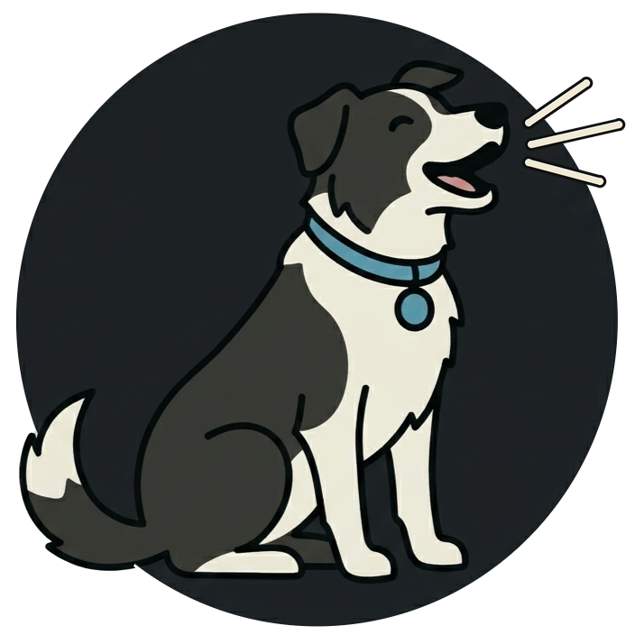
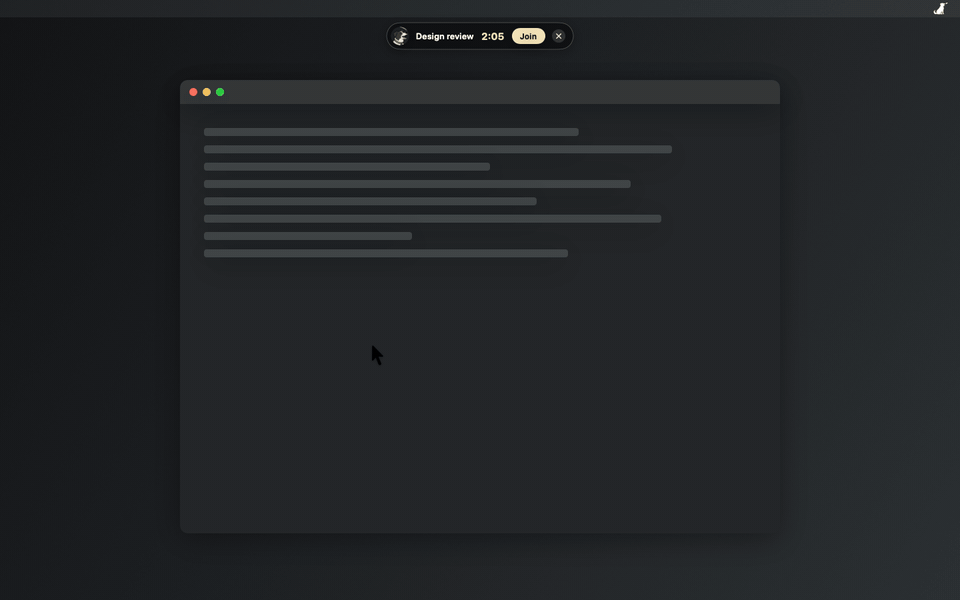

  <picture>
    <source media="(prefers-color-scheme: dark)" srcset="art/tug.png">
    
  </picture>

# Sheepdog

The demo is drawn by the app itself from its real alert views over a made-up desktop. Rebuild it
with `make demo`, which needs `ffmpeg`.

## Credits

Tug's bark is cut from [Ladrido perro](https://commons.wikimedia.org/wiki/File:Ladrido_perro.ogg)
by Edo.pt2 on Wikimedia Commons, released under
[CC0 1.0](https://creativecommons.org/publicdomain/zero/1.0/).
