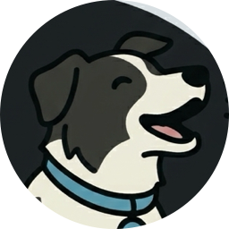
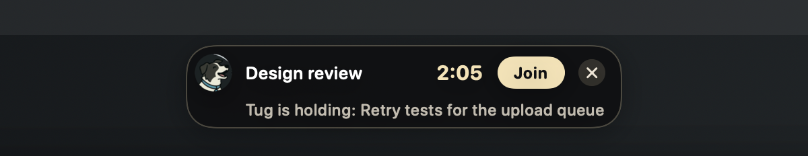
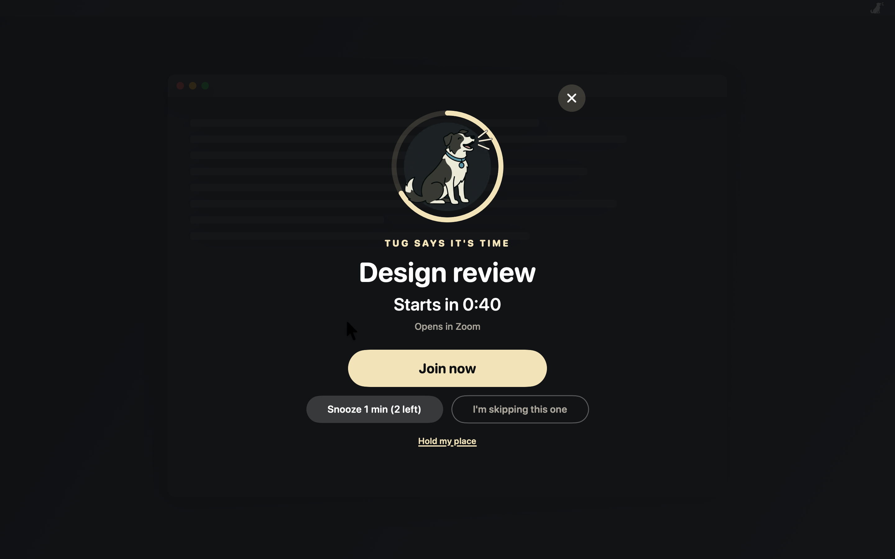
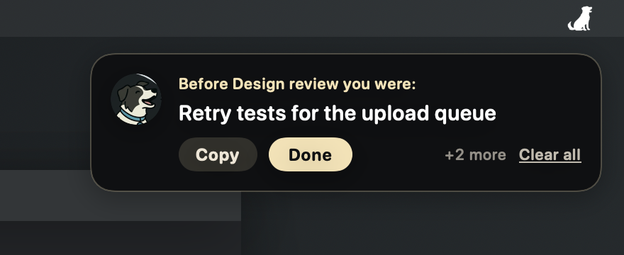

<h1 align="center">Using sheepdog</h1>

sheepdog reads every calendar in macOS Calendar, including Google and Exchange, and escalates in
three steps as each meeting gets closer. Each step is described below in the order it happens.

## The countdown pill

Ten and five minutes before the start, Tug woofs once and a small pill shows the countdown at the
top of the screen. It has a Join button and stays out of the way of your work. The X hides the
pill, and the alarm still comes a minute before the start.

## The alarm

A minute before the start, the alarm covers every display and Tug starts barking. The ring
around Tug empties as the start gets closer and turns red once the meeting has started.

- **Join now** opens the meeting link in the app or the browser, whichever you pick for that
  service in Settings, Alerts, Join. Google Meet has no Mac app, so it always opens in the browser.
  Events with no link say **I'll attend**.
- **Snooze** drops back to the countdown for a minute, or 30 seconds once the meeting has
  started. Each meeting gets two snoozes.
- **I'm skipping this one** ends the alerts for that meeting.
- The **X** stops the barking and leaves only the silent countdown pill for that meeting.
- Starting a call once a meeting is about to begin counts as joining it and quiets its alarm. A call
  that was already running when the meeting came up does not, so back-to-back meetings still bark.

When the alarm closes, focus goes back to the app you were using.

## Hold my place

Before the meeting, jot down what you were in the middle of, from the pill or with **Hold my
place** on the alarm. Clicking it quiets Tug while you type. When the meeting ends, a card in the
top right corner of your main display hands the note back.

- **Copy** puts the note on the clipboard. **Done** puts the card away.
- The card waits while your mic is still in use, so it shows up when the call is over.
- More than one note stacks newest first, like macOS notifications, with **Clear all**.
- Notes nobody picked up are cleared at 4 a.m.

## Let them know

Add your team's Slack channels in Settings, under Slack. Use **Copy link** on a channel in Slack
and paste it in, with a name such as #team. The alarm then shows **Let them know** next to
**Hold my place**.

- **Running late** copies "Running a few minutes late to Design review." and opens the channel.
  The alarm drops to the countdown pill, so the meeting is still tracked.
- **Can't make it** copies "I can't make Design review." and opens the channel. The meeting
  counts as skipped, the same as **I'm skipping this one**.
- With more than one channel, pick one first. Paste and press Return in Slack to send.
- sheepdog never signs in to Slack and never sends anything itself.

## Working hours

Turn on **Only bark during working hours** in Settings to keep Tug quiet in the evening or on
weekends. It starts at 8:00 to 18:00, Monday to Friday. Change the times and days to fit.

- **Outside working hours** picks what Tug does for a meeting outside your hours. **Silent** says
  nothing, like Nap time. **Quiet** shows the countdown pill with no sound and no alarm. **Full
  alarm** treats every meeting the same, as if working hours were off.
- Tug goes by when the meeting starts. With hours ending at 17:00, a 16:55 meeting alarms in full
  even if you snooze past 17:00, and a 17:05 meeting is outside your hours from start to finish.
- Meetings outside your hours stay in Tug's menu, marked "after hours". Hover over the glyph to
  see when he is back, e.g. "Off duty until Mon 8:00 AM".
- **Nap time** offers **Until work starts** instead of until morning.
- **Test the alarm** always runs the full alarm.
- Working hours are kept on this Mac only. Phone calendar apps alert on their own.

Examples:

| You want     | Start | End   | Days            |
|--------------|-------|-------|-----------------|
| Evenings off | 8:00  | 18:00 | Every day       |
| Weekends off | 0:00  | 0:00  | Monday-Friday   |
| Night shift  | 22:00 | 6:00  | Sunday-Thursday |

A start and end that match cover the whole day. An end before the start is an overnight shift,
and it belongs to the day it starts, so a Thursday 22:00 shift runs into Friday morning.

## Install and update

Open the disk image from the latest release and double-click Sheepdog. Click **Install** and it
copies itself into Applications, starts from there, ejects the disk image, and moves it to the
Trash. Dragging Sheepdog onto Applications works too, and then it asks once before moving the
disk image to the Trash. A downloaded copy started from anywhere else, such as Downloads,
offers **Move to Applications**. Homebrew users can run
`brew install --cask dcadolph/tap/sheepdog` instead.

Every six hours Sheepdog asks GitHub for the latest release. The first check waits a minute
after launch. The check sends no version or identifier.

When a newer release is out and **Install updates automatically** is on, Sheepdog downloads the
release zip and its `SHA256SUMS` file from GitHub's release files and checks the zip's hash
against it. It unpacks the zip and checks that the app inside carries a valid Apple Developer ID
signature from team `U7L4P2YHWJ`, matches the running app's signing requirement, is notarized by
Apple, and is the expected newer version that runs on this macOS. Any failed check stops the
update and names the step.

It then installs at a quiet moment. It never installs during an alarm (countdown, takeover or
hand-back card), a call (microphone live), off hours, a meeting under way or within 15 minutes of
the next meeting, or while a Sheepdog window is open. It also waits for 30 seconds without
keyboard or mouse input. Then it swaps the app in Applications and starts again. If it finds no
quiet moment before you quit, it installs on the next launch. If the new version does not start,
Sheepdog puts the previous version back and never tries that version again, and a card says so.

Two switches in Settings, under General, control this. **Check for updates** is on by default.
**Install updates automatically** is on by default and grayed out while checks are off. With
installs off, Tug's menu shows "Sheepdog 1.17.1 is available", and choosing it opens the release
page.

While an update is under way, the top of Tug's menu shows one status line: "Downloading 1.17.1",
"1.17.1 ready, installs when you pause", "Installing 1.17.1", or "1.17.1 refused at" followed by the
step. Hover for the reason. Choosing the refused line opens the release page.

After an update a card says "Sheepdog updated to 1.17.1". The first time, it says "Sheepdog now
installs updates on its own. Change that in Settings." with **Open Settings**. Later updates say
"Updated from 1.17.0." with **What's New**.

**Check for Updates…** in Tug's menu checks at once and answers in a dialog. **Update Now** there
downloads, verifies and installs right away without waiting for a quiet moment. It installs only
when Sheepdog runs from Applications. Otherwise the button is **View Release**.

The Homebrew cask is marked `auto_updates`, so `brew upgrade` leaves Sheepdog to update itself.
`brew upgrade --greedy --cask sheepdog` forces it.

## Tug's collar

Eighteen collars in Settings, Look: Jax, BlackDiamond, GoldenSpark, Rubie, Lightning, Thunder,
StrawHat, Bubblegum, Berserker, PickleJuice, Trunk, MintChip, Rose, FogDog, VolcanoTaffy,
Gambit, PaleNimbus and DangerRoom. Each one colors the collar, the
alarm, the countdown pill and the hand-back card, and every one is checked for contrast. Pick **Custom** to choose your
own: a background and a ring and buttons color are required, the collar and the already-started
color are optional. Tug works out the text, surface and muted colors so everything stays readable,
and if a color you picked would not read, he moves it a little and says so under the picker.
**Start from** copies any collar's colors into Custom as a starting point. The color panel takes a
hex value or a drag around the wheel.

## Holiday outfits

Tug dresses up in the days around seven holidays: a party hat for New Year's (Dec 27 to Jan 2), a
heart headband for Valentine's Day (Feb 10 to 14), a green top hat for St. Patrick's Day (Mar 13 to
17), bunny ears for Easter (the Saturday before through the Tuesday after), a vampire cape for
Halloween (Oct 24 to 31), a turkey hat for Thanksgiving week (Monday to Sunday), and a Santa hat for
Christmas (Dec 18 to 26). The outfit goes over any collar and shows on the alarm, the countdown
pill, the hand-back card and Settings. The menu bar keeps plain Tug. Outfits start off. Turn on
**Dress Tug up for holidays** in Settings, Look, or on the setup window's dress-up step.

In the same days the alarm barks a holiday tune instead of the plain bark: Auld Lang Syne, Let Me
Call You Sweetheart, The Irish Washerwoman, In the Hall of the Mountain King, Over the River and
Through the Wood, and Jingle Bells. Easter has no tune. Every note is Tug's own woof. The tune plays
only when the alarm sound is one of Tug's, and the warning chime stays a single woof. Tunes start
off too. Turn on **Bark holiday tunes** in Settings, Sound, or on the same setup step.

## First run

On a new install the **Set up Sheepdog** window walks through five steps.

1. **Welcome** says why Tug reads your calendars. Click **Allow calendar access** and macOS asks,
   or click **I don't use macOS Calendar** to skip it.
2. **Connect calendars** shows the calendars Tug reads through Apple Calendar and lets you sign
   in directly to Microsoft 365, iCloud, Exchange on-prem or another CalDAV server.
3. **When should Tug bark?** sets working hours, which start off, and the **Warn at** minutes.
4. **Tug dresses up** has **Dress Tug up for holidays** and **Bark holiday tunes**, both off.
5. **Done** has **Start Sheepdog at login** and **Test the alarm**.

Closing the window counts as finished, so it shows once. An upgrade from an earlier version turns
outfits and tunes off once and shows only the last two steps, titled "What's new: Tug dresses up".
**Set up Sheepdog…** in Tug's menu reopens the window at **Connect calendars**.

Later, Tug shows a card if he can't see a calendar, sees Outlook but no Microsoft calendar, or has
not seen a meeting in a week. Choose **Open Calendars settings**, **Later** or **Don't ask
again**. **Connected through Apple Calendar**, in the Calendars tab, lists each account macOS
Calendar holds with its calendar count, such as Exchange or iCloud, and updates by itself when an
account is added or removed. **Direct sign-in (optional)** below it holds the accounts Sheepdog
signs in to itself. A service Tug already reads through Apple Calendar says **Already read
through Apple Calendar** there, and needs nothing more.

Every calendar in Apple Calendar barks at first, including ones added later. To keep one quiet,
open its account under **Connected through Apple Calendar** and uncheck it. The account's row then
shows how many of its calendars Tug reads, such as "3 of 5 calendars". Direct sign-ins have no
checkboxes yet.

iCloud and Other CalDAV sign in directly from Settings, Calendars. The iCloud sheet asks for your
Apple ID and an app-specific password. Make one at account.apple.com, under Sign-In and Security,
with the same Apple ID that holds your iCloud calendars. Your Apple ID password will not work
here, and a new app-specific password can take about a minute before iCloud accepts it. Other
CalDAV asks for a server address such as https://caldav.fastmail.com, a user name and a password.
Sheepdog only reads your calendars and keeps the password in your Keychain.

Exchange on-prem (beta) also signs in directly. It asks for a server address such as
https://mail.example.com, a user name or email, and a password. When you give only the server,
sheepdog adds /EWS/Exchange.asmx itself, and a full EWS path is kept as typed. The address must
start with https://. Sheepdog connects over Exchange Web Services, only reads your calendars, and
keeps the password in your Keychain.

A meeting that arrives both through macOS Calendar and a direct sign-in shows once.

If your company blocks direct sign-in, add the work account in System Settings, Internet Accounts,
with Calendars turned on, where your company allows that. Tug reads it through macOS Calendar, so
he needs no approval of his own. It then shows under **Connected through Apple Calendar**. The
card and that section say so too, with an **Open Internet Accounts** button.

## Settings and features

| Feature       | What it does                                                               |
|---------------|----------------------------------------------------------------------------|
| Calendars     | Reads every calendar in macOS Calendar, including Google and Exchange.     |
| Join links    | Finds Teams, Zoom, Meet, Webex and Slack links. Each opens where you pick. |
| Let them know | Copies a running late or can't make it line and opens your Slack channel.  |
| Volume        | Unmutes and raises the volume while the alarm plays, then puts it back.    |
| Speakers      | Plays through headphones, built-in speakers, or both at once.              |
| Sounds        | Tug's bark and woof, or any macOS system sound.                            |
| Filters       | Skips tentative events by default, and solo events if you turn that on.    |
| Timing        | Warning times, alarm lead, snooze lengths and snooze count are adjustable. |
| Login         | Starts at login from Settings.                                             |
| Menu bar      | Tug's glyph changes with the alert stage and the menu lists what is next.  |
| Events        | Each meeting in the menu offers Join meeting and Open in Calendar.         |
| Nap time      | Silences real meetings for 1 or 3 hours, until morning, or until woken.    |
| Motion        | Tug lies down to nap, barks on waking and at launch, and leaps out on quit. |
| Hours         | Keeps Tug quiet, or down to the countdown, outside your working hours.     |
| Hover         | The glyph says what is next, and each menu item says what it does.         |
| Backup        | Exports settings to a file and imports them on any Mac. Sign-ins stay out. |
| Collar        | Eighteen collars for Tug that also color the alarm, pill and hand-back card, or Custom. |
| Outfits       | Holiday outfits for Tug. Dress Tug up for holidays turns them on.          |
| Tunes         | Holiday tunes for the alarm, in barks. Bark holiday tunes turns them on.   |
| Updates       | Checks GitHub every six hours and installs a verified update.              |

When a direct sign-in is refused, the message says why and what to do next, and the
[For IT admins](https://macsheepdog.com/admins) page covers what an admin approves.

Use **Test the alarm** in Tug's menu to see the whole thing without a real meeting. While Tug
naps, the test shows the alarm without sound.
